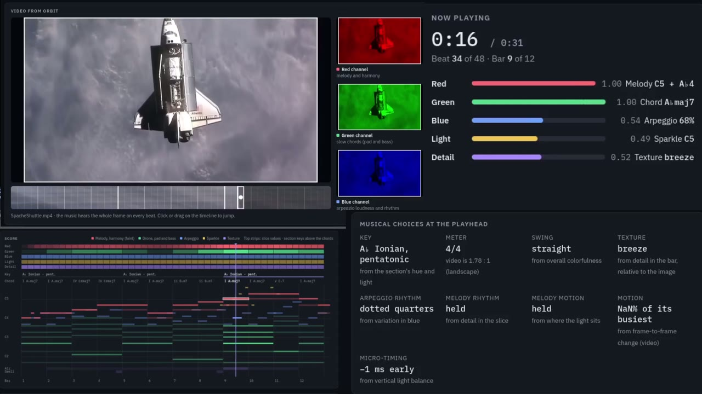

# Geosonic

Geosonic turns photographs and videos of Earth taken from space into slow, peaceful music. Oceans, forests, deserts, clouds and city lights each get a sound of their own. That gives people who are blind or have low vision a way into images that are usually only seen, and lets blind and sighted listeners hear the same picture together.

Everything runs in the browser. Photos and videos you open are never uploaded.

[](docs/SpaceShuttle.mp4)

## Running it

There is no build step and nothing to install.

- Open `index.html` in a browser for the landing page, or `app.html` to go straight to the app.
- Or serve the folder with any static file server, for example:

  ```sh
  python3 -m http.server 8000
  # then open http://localhost:8000
  ```

The scripts are plain `<script>` files rather than ES modules, so the pages also work when opened straight from disk (`file://`). MP4 export uses WebCodecs where the browser supports it and falls back to MediaRecorder otherwise.

## Using the app

1. Click **Open a photo or video of Earth…** (PNG, JPEG, WebM or MP4), drop a file on the picture, or click **Use sample**.
2. Press **Play** (or Space). The highlighted slice shows what the music is hearing right now.
3. Adjust the controls:
   - **Beats:** how many slices an image is cut into. A video's length sets this instead.
   - **Tempo:** the speed, in BPM.
   - **Video scan:** for videos, either a *sweeping strip* that crosses the frame once per section, or the *whole frame* on every beat.
   - **Volume** and **Reverb.**
   - **Follow cursor** (spotlight mode): only the circle under the cursor is heard, composed live. Scroll over the picture to resize the circle. This works on images and on videos; a video keeps playing in a loop underneath.
4. Choose the band: pick a preset soundscape, or tap a part's bubble to choose its instrument. Untick a part to mute it.
5. Click or drag on the image (or on a video's timeline) to jump to a point in the piece.
6. **Export** the result as audio (MP3) or video (MP4).

The red, green and blue panels next to the picture show each colour channel, with the same highlight as the main view. Below them, **Now playing**, **Musical choices** and the **Score** show what each part is playing and which part of the picture caused it.

## How the picture becomes music

1. **Scan.** An image is read from left to right in thin vertical slices, one slice per beat. A video is read through time, so the music lasts as long as the video and stays in sync with it.
2. **Measure.** Each slice is split into red, green and blue. From those come its brightness, hue, colourfulness, detail, where the light sits vertically and, for video, how much the picture moves.
3. **Compose.** Slices are grouped into bars and four-bar sections. Each section gets a key and a mode, chords change every two bars, and a smooth melody is written with a harmony line a third below.
4. **Play.** An eight-part band plays the score in a long, dark reverb.

| What the picture has | What you hear |
| --- | --- |
| Red | The melody's pitch, and the harmony that follows it |
| Green | Which chord plays (I, ii, IV, V or vi of the key) |
| Blue | How loud the arpeggio is, and its rhythm |
| Light | The mode, from bright Lydian down to gentle minor; sparkles on the brightest slices; rests in the dark |
| Hue | The key of each section, moving around the circle of fifths, and the drone |
| Detail and motion | How busy the melody is, and the strength of the texture |
| Shape | The meter: 3/4 for portrait, 4/4 for landscape, 5/4 for panoramas |
| Colourfulness | A little swing; grey passages switch to a pentatonic melody |

## Project structure

```
index.html            Landing page: what it is, why sound, how it works, the band
app.html              The app
static/style.css      Shared styles and the app layout
static/landing.css    Landing page styles
static/js/
  constants.js        Shared constants (parts of the band, sections, colours)
  voices.js           Instrument definitions, which instruments each part can use, presets
  icons.js            Line icons for every instrument
  util.js             Small helpers
  state.js            App state
  media.js            Loading images and videos into analysable pixel data; the sample image
  analysis.js         Per-beat, per-bar and per-section measurements
  theory.js           Scales, modes, keys and chords
  composer.js         Turns the measurements into a score
  instruments.js      Sound synthesis (additive, pad, gliding line and noise engines)
  playback.js         Web Audio graph, play/pause, reverb
  view.js             Drawing the picture, channels, timeline, score and readouts
  reactive.js         Spotlight mode (Follow cursor)
  export.js           MP3 and MP4 export
  landing.js          Fills in "The band" on the landing page
  app.js              Wiring: controls, instrument mixer, scrubbing, start-up
  lame.min.js         lamejs, for MP3 encoding (third-party)
  mp4-muxer.min.js    mp4-muxer, for MP4 export (third-party)
```

The scripts share one global scope and must load in the order listed in `app.html`.

## Third-party code

- [lamejs](https://github.com/zhuker/lamejs) for MP3 encoding (LGPL-3.0)
- [mp4-muxer](https://github.com/Vanilagy/mp4-muxer) 5.2.2 for building MP4 files (MIT)
- Fonts from Google Fonts: Sora, IBM Plex Sans and IBM Plex Mono

## License

MIT. See [LICENSE](LICENSE). The third-party libraries above keep their own licenses.
